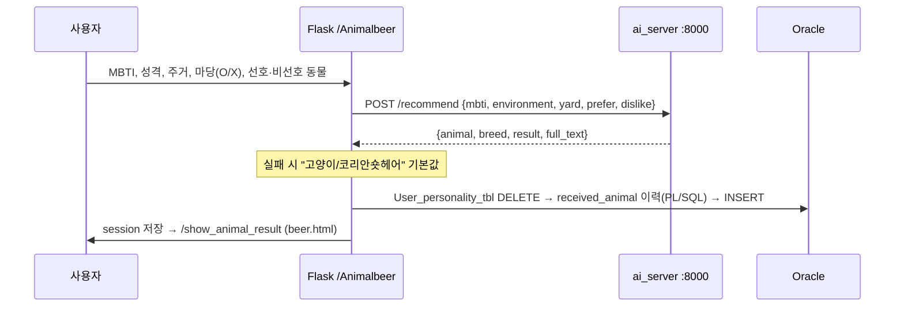

# 01. Flask 웹앱 (`test/app.py`)

## 개요
| 항목 | 내용 |
|---|---|
| 파일 | `Gemini_test/Gemini_test/test/app.py` (1,612줄) |
| 실행 | `app.run(host='0.0.0.0', port=2121, debug=True)` |
| 프레임워크 | Flask + Jinja2 템플릿 (`templates/`), 정적 파일 (`static/`) |
| DB | `db_config.db()` → Oracle (요청마다 `g.db`에 연결, teardown 시 close) |
| 비밀번호 해시 | argon2 (`time_cost=3, memory_cost=64MB`), 로그인 시 필요하면 재해싱 |
| 외부 연동 | MBTI AI(:8000), Big Five AI(:8001), Gemini 2.5 Flash, Gmail SMTP, Google/Kakao OAuth |
| 프록시 | `ProxyFix(x_proto=1, x_host=1)` — Cloudflare 뒤에서 HTTPS URL 생성용 |

## 라우트 전체

### 회원·인증
| 경로 | 메서드 | 기능 | 템플릿 |
|---|---|---|---|
| `/` | GET/POST | 메인 + ID/PW 로그인 (argon2 검증) | `index.html` |
| `/Login` | GET/POST | 로그인 후 메인 (닉네임 세션 저장) | `Login.html` |
| `/Logout` | GET/POST | 세션 초기화 | `index.html` |
| `/NewUser` | GET/POST | 회원가입 (중복확인 세션 필수, 닉네임·이메일 중복 검사) | `NewUser.html` |
| `/dup` | POST | 아이디 중복 확인 → `session['id_checked']` | – |
| `/reset_id_check` | POST | 중복확인 상태 초기화 (204) | – |
| `/Useredit` | GET/POST | 비밀번호·닉네임 수정 | `Useredit.html` |
| `/send_withdraw_code` | POST | 탈퇴 인증번호 메일 발송 (JSON) | – |
| `/Withdraw` | GET/POST | 인증번호 확인 후 회원탈퇴 (JSON) | `Withdraw.html` |
| `/FindAuth` | GET | 아이디/비밀번호 찾기 화면 (step 파라미터로 단계 전환) | `FindAuth.html` |
| `/find_id_send` → `/find_id_resend` → `/find_id_confirm` | POST | 이메일 인증번호(6자리 숫자)로 아이디 찾기 | `FindAuth.html` |
| `/find_pw` → `/find_pw_resend` → `/reset_pw` | POST | 이메일 인증코드(6자리 영숫자)로 비밀번호 재설정 | `FindAuth.html` |
| `/login/google` → `/login/google/authorize` | GET | 구글 OAuth (authlib) | – |
| `/login/kakao` → `/login/kakao/authorize` | GET | 카카오 OAuth (requests로 직접 토큰 교환) | – |
| `/set_name` | GET/POST | 소셜 신규 가입자 닉네임 설정 후 INSERT | `set_name.html` |

### 추천
| 경로 | 메서드 | 기능 | 호출 대상 | 템플릿 |
|---|---|---|---|---|
| `/select_method` | GET/POST | MBTI / Big Five 선택 | – | `select_method.html` |
| `/Animalbeer` | GET/POST | MBTI 추천 입력·요청 | `:8000/recommend` (timeout 40s) | `Animalbeer.html` |
| `/show_animal_result` | GET | MBTI 결과 표시 (세션 데이터) | – | `beer.html` |
| `/beer` | GET/POST | MBTI **재추천** (최근 5품종 제외) | `:8000/recommend` | → `/show_animal_result` |
| `/Bigfive` | GET | Big Five 설문 화면 (10문항) | – | `Bigfive.html` |
| `/Animalbeer/bigfive` | POST | Big Five 점수 계산·추천 요청 | `:8001/recommend_bigfive` (timeout 60s) | → `/result_big5` |
| `/result_big5` | GET | Big Five 결과 표시 | – | `Bigfiveresults.html` |
| `/Animalbeer/re_recommend` | POST | Big Five 재추천 (받았던 품종 전체 제외) | `:8001/recommend_bigfive` | → `/result_big5` |

### 통계·이력·Q&A
| 경로 | 메서드 | 기능 | 템플릿 |
|---|---|---|---|
| `/Group` | GET/POST | 동물별·MBTI별 추천 통계 (차트) | `Group.html` |
| `/sub_select` | POST | MBTI로 통계 필터 | `Group.html` |
| `/Ani_in` | GET/POST | MBTI × 동물 → 품종별 인원 | `Ani_in.html` |
| `/User_Animal` | GET/POST | 내가 받은 추천 최근 5개 | `User_Animal.html` |
| `/info` | GET/POST | Gemini 반려동물 Q&A (300자 제한 프롬프트) | `info.html` |

### 게시판
| 경로 | 메서드 | 기능 | 템플릿 |
|---|---|---|---|
| `/board` | GET | 목록 (10개씩 페이징, ROWNUM) | `board.html` |
| `/board/search` | GET | 제목 검색 + 페이징 | `board.html` |
| `/write` | GET/POST | 글쓰기 (**추천을 한 번 이상 받은 사용자만**) | `Write.html` |
| `/detail/<bono>` | GET | 상세 + 계층형 댓글 (`CONNECT BY`) | `detail.html` |
| `/edit/<post_id>` | GET/POST | 수정 (작성자 또는 `admin`) | `edit.html` |
| `/delete/<post_id>` | GET/POST | 삭제 (댓글 → 게시글 순) | – |
| `/comment/add` | POST | 댓글·대댓글 | – |
| `/comment/edit/<cno>` | POST | 댓글 수정 (작성자만) | – |
| `/comment/delete/<cno>` | POST | 자식이 있으면 내용을 `'NULL'`로, 없으면 실제 삭제. 빈 부모도 연쇄 삭제 | – |

### 기타
| 경로 | 기능 |
|---|---|
| `/test_servies` | 테스트 페이지 (`test_servies.html`, Google Forms 링크 포함) |
| `after_request` | 모든 응답에 캐시 금지 헤더 |

## 핵심 흐름

### MBTI 추천

### Big Five 점수 계산 (`/Animalbeer/bigfive`)
설문 10문항(1~5점)을 2문항씩 묶어 0~1로 정규화:

| 차원 | 문항 | 계산식 |
|---|---|---|
| E 외향성 | q1, q2 | (q1+q2)/2/5 |
| A 친화성 | q3, q4 | (q3+q4)/2/5 |
| C 성실성 | q5, q6 | (q5+q6)/2/5 |
| N 신경성 | q7, q8 | (q7+q8)/2/5 |
| O 개방성 | q9, q10 | (q9+q10)/2/5 |

→ `received_animal`에서 지금까지 받은 품종 전체를 `exclude`로 보냄 → 결과는 DB에 `TYPE='BIG5'`로 저장

## 템플릿 ↔ 라우트 연결 (HTML 안의 링크·action 기준)
| 템플릿 | 호출하는 경로 | 비고 |
|---|---|---|
| `Login.html` | `/Login_Process`, `/NewUser`, `/Useredit`, `/Withdraw` | ⚠️ `/Login_Process` 라우트 없음 (404) |
| `NewUser.html` | `/dup`, `/reset_id_check`, `/login/google`, `/login/kakao` | |
| 나머지 | 위 라우트 표와 일치 | |

미사용 템플릿(`find_pw.html`, `reset_pw.html`)은 [99a_archive.md](99a_archive.md) 참고.

CSS는 `static/` 아래 34개 (페이지별 1개 + `variables.css`, `base.css`, `buttons.css`, `form-inputs.css`, `responsive.css` 등 공통 스타일). 이미지는 `static/image/` (로고 + 품종 사진 8장, 폴더 이름은 한글이 깨져 보임 — 인코딩 문제, **확인이 필요함**).

## 세션 키 정리
| 키 | 용도 |
|---|---|
| `US_id`, `US_name` | 로그인 사용자 ID·닉네임 |
| `id_checked`, `checked_user_id` | 회원가입 중복확인 |
| `auth_code`, `temp_user_id`, `auth_email` | 아이디 찾기 |
| `reset_code`, `reset_user` | 비밀번호 재설정 |
| `withdraw_auth_code` | 회원탈퇴 인증 |
| `temp_google_email`, `temp_google_id` | 소셜 신규 가입 (카카오도 같은 키 사용) |
| `animal_result_data` | 최근 추천 결과 (텍스트, 동물, 품종, 입력값, big5 점수) |
