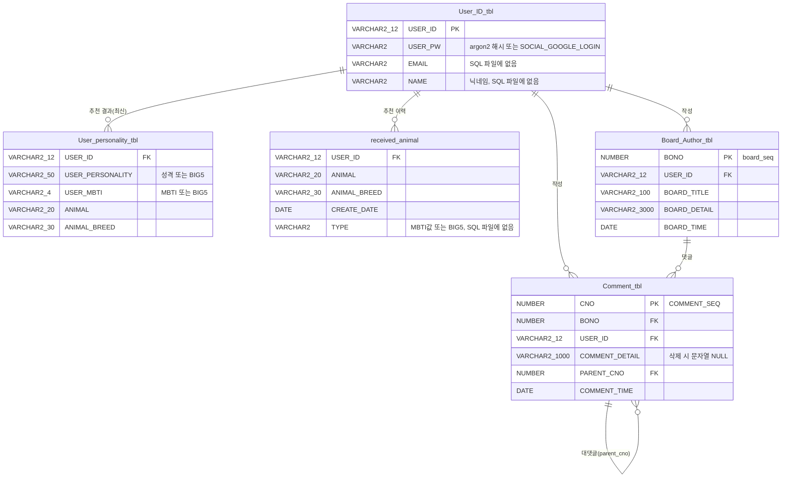

# 02. 데이터베이스 (Oracle XE)

## 연결 정보 (`test/db_config.py`)
| 항목 | 값 |
|---|---|
| 드라이버 | `oracledb` thick 모드 (`init_oracle_client(lib_dir=".../instantclient_23_26")`) |
| 호스트 | `192.168.210.167:1521`, service_name `xe` |
| 계정 | `Animal_DB` / `***` |
| 방식 | `db()` 호출마다 새 연결 (커넥션 풀 없음) |

> 폴더에는 Instant Client **23.8** zip이 있지만 코드는 **23_26** 경로를 씀 → 서버에는 다른 버전이 설치된 것으로 추정

## ERD (코드 기준으로 재구성)

## `GeminiDB.sql` ↔ 실제 코드 불일치
`GeminiDB.sql`은 **초기 설계 초안**이고, 실제 DB는 이후 ALTER된 것으로 보인다. 현재 스키마는 `user_tab_columns`로 직접 확인해야 함(**확인이 필요함**).

| 테이블 | SQL 파일 | 코드가 쓰는 것 | 영향 |
|---|---|---|---|
| `User_ID_tbl` | `User_PW VARCHAR(20)` | argon2 해시(약 97자) 저장 | SQL대로라면 INSERT 실패 → 실제 DB는 길이가 늘어난 상태일 것 |
| `User_ID_tbl` | ID, PW만 | `EMAIL`, `NAME` | 컬럼 추가됨 |
| `User_personality_tbl` | PK 없음 | 사용자당 1행처럼 다룸 (DELETE 후 INSERT) | `/beer`는 DELETE 없이 INSERT → 행이 중복되거나(PK 없음) INSERT 실패(PK 있음) |
| `received_animal` | `TYPE` 없음 | `TYPE`(MBTI값/`BIG5`) | 컬럼 추가됨 |
| `Board_comment_tbl` | 정의됨 (`VALUE(300)` 문법 오류, "아직 안됨" 주석) | 미사용 | `Comment_tbl`로 대체됨 |
| 설계만 있고 안 만든 것 | `Gemini_beer_tbl`, `Gemini_tbl`, `Animal_stcs` | 없음 | 통계는 `User_personality_tbl` GROUP BY로 대체 |

## 시퀀스
| 이름 | 설정 | 주의 |
|---|---|---|
| `board_seq` | 1부터, `MAXVALUE 99999 NOCYCLE NOCACHE` | 게시글 99,999개를 넘으면 INSERT 오류 |
| `COMMENT_SEQ` | 1부터, NOCACHE | – |

## FK 제약과 회원탈퇴
모든 FK에 `ON DELETE CASCADE`가 **없다**. 그런데 `UserDAO.secession()`은 `User_ID_tbl`만 DELETE한다.
→ 추천을 한 번이라도 받았거나 글·댓글을 쓴 사용자는 **ORA-02292(자식 레코드 존재)로 탈퇴에 실패**할 가능성이 높다 (**확인이 필요함**).

## DAO ↔ 테이블 매핑

### `UserDAO` → `User_ID_tbl`
| 메서드 | SQL | 호출 위치 |
|---|---|---|
| `duplicate(user_id)` | SELECT by ID | `/dup`, `/NewUser` |
| `get_password_hash` | SELECT user_pw | `/` 로그인 |
| `insert_user(dto)` | INSERT (id, pw, email, name) | `/NewUser` |
| `update_password_hash` | UPDATE pw | 로그인 재해싱 |
| `check_user_for_pw` | ⚠️ `self.cursor`·`USER_EMAIL` 사용 → 호출하면 에러 (미사용) | – |
| `secession` | DELETE | `/Withdraw` |
| `username` | SELECT name | `/Login` |
| `Update_user(dto)` | UPDATE pw/name (조건 분기) | `/Useredit` |
| `find_id_by_email` | SELECT by EMAIL | `/find_id_send` |
| `uni_name`, `uni_email` | 닉네임·이메일 중복 | `/NewUser` |

### `AnimalDAO` → `User_personality_tbl`, `received_animal`
| 메서드 | 내용 | 호출 위치 |
|---|---|---|
| `get_Animal` | 사용자 최신 추천 1행 | Big Five |
| `get_beerd` | 사용자 품종 목록 | `/beer` (결과가 곧바로 덮어써져 사실상 미사용) |
| `InAnimal(dto)` | 최신 추천 INSERT | 전체 추천 흐름 |
| `re_animal(dto)` | PL/SQL: (사용자, TYPE)별 5개 이상이면 가장 오래된 1개 삭제 후 INSERT | 전체 추천 흐름 |
| `delet` | 최신 추천 DELETE | 추천 흐름 |
| `Group_tbl`, `group_total` | 동물별 COUNT | `/Group` |
| `group_all` | MBTI×동물 COUNT | `/Group` |
| `wher` | 동물별 품종·성격·MBTI | 미사용 |
| `get_user_animals` | 사용자별 최근 5개만 남기고 삭제(ROW_NUMBER) → 조회 + **commit** | `/User_Animal` |
| `filtered(MBTI)` | 특정 MBTI의 동물별 COUNT | `/sub_select` |
| `animal_drop` | DISTINCT MBTI (드롭다운) | `/sub_select` |
| `breed_animal(MBTI, animal)` | 품종별 COUNT | `/Ani_in` |

> **설계**: Big Five 결과는 `User_MBTI='BIG5'`, `User_personality='BIG5'`로 저장하여, 통계 화면에서 MBTI 16유형과 함께 하나의 유형으로 비교한다 (의도된 구성).

> 이력 보관 기준이 두 군데에서 다르다: `re_animal`은 **TYPE별 5개**, `get_user_animals`는 **전체 5개**.

### `BoardDAO` → `Board_Author_tbl`, `Comment_tbl`, `user_id_tbl`
| 메서드 | 내용 |
|---|---|
| `get_total_count`, `boardmain(offset, per_page)` | 목록·페이징 (ROWNUM 이중 서브쿼리, 작성자 닉네임 JOIN) |
| `get_post_detail` | 상세 |
| `get_comments` | `CONNECT BY` 계층 댓글. 내용이 `'NULL'`인 리프 댓글은 숨김 |
| `check_write_power` | 추천 이력이 있어야 글쓰기 가능 |
| `in_board`, `in_comment` | INSERT (시퀀스) |
| `power_board`, `update_board` | 게시글 수정 권한·수정 |
| `update_power`, `update_comment` | 댓글 수정 권한·수정 |
| `get_comment_info`, `get_child_count`, `mark_deleted_comment`, `delete_comment`, `delete_empty_parent` | 댓글 소프트/하드 삭제와 빈 부모 정리 |
| `select_board`, `delete_board_comments`, `delete_board` | 게시글 삭제 |
| `get_search_count`, `get_search_list` | 제목 LIKE 검색 + 페이징 |

### DTO
| 파일 | 클래스 | 비고 |
|---|---|---|
| `UserDTO.py` | `UserDTO(user_id, user_pw, user_email, user_name)`, `Hasher`, `Update_user` | `Hasher` 미사용 |
| `AnimalDTO.py` | `AnimalDTO`, `UserAnimalList(…, type)`, **`list`** | ⚠️ `class list`가 파이썬 내장 `list`를 덮어씀 (app.py에서 `import *`) |
| `BoardDTO.py` | `BoardDTO` | 미사용 (DAO가 dict/tuple을 직접 반환) |
