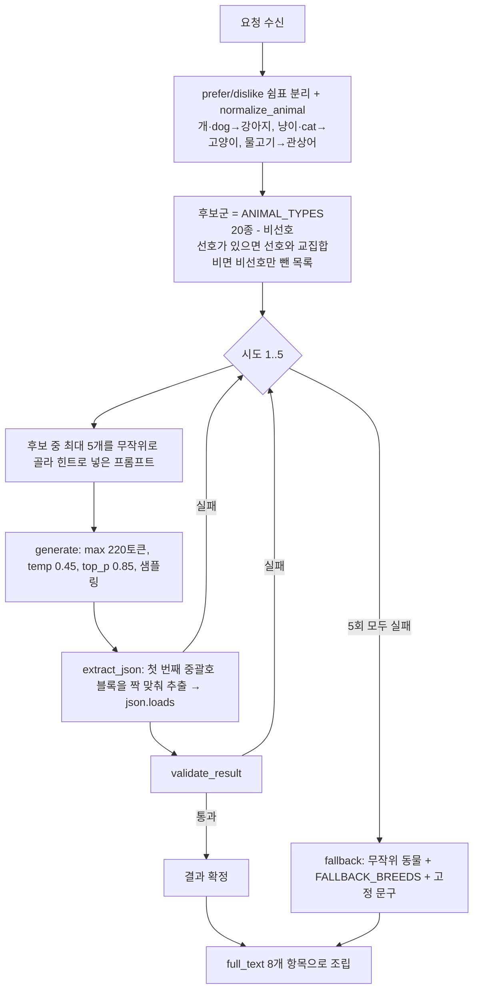

# 03. MBTI 추천 AI 서버 (`ai_server.py`)

## 개요
| 항목 | 내용 |
|---|---|
| 실행 | `uvicorn` 0.0.0.0:**8000** |
| 엔드포인트 | `POST /recommend` (동기 `def`) |
| 모델 | `/home/soulpow_2121/Soulpow_AI/llama3_model` (4bit) + LoRA `/home/soulpow_2121/trained_mbti_expert_v3` (`PeftModel`) |
| 호출하는 곳 | Flask `/Animalbeer`, `/beer` |

## 입력 스키마 `UserInput`
| 필드 | 타입 | 기본값 | Flask에서 넘기는 값 |
|---|---|---|---|
| `mbti` | str | 필수 | 대문자 4글자, 기본 `INTJ` |
| `environment` | str | 필수 | `아파트` 등 |
| `yard` | str | 필수 | `O` / `X` (기본 `X`) |
| `prefer` | str | `"없음"` | 쉼표로 여러 개 가능 |
| `dislike` | str | `"없음"` | 쉼표로 여러 개 가능 |
| `exclude_breeds` | list[str] | `[]` | 최근 받은 5품종 (`/beer`만) |

## 처리 흐름


### `validate_result` 검증 순서
1. 필수 키 7개: `animal_type, breed, reason, warning, environment_fit, size_text, guide`
2. 품종 길이가 2자 이상
3. `animal_type`이 `ANIMAL_TYPES`에 포함
4. 선호 동물이 지정됐다면 그중 하나
5. 비선호 동물·품종이 아님 (`is_disliked`)
6. 제외 품종이 아님 (`is_excluded`: 공백 제거, 소문자 변환 후 **양방향 부분 문자열** 비교)

### 프롬프트 (요약)
```
JSON만 출력하라. { "animal_type":"강아지", "breed":"푸들", ... }  ← 예시가 강아지/푸들로 고정
JSON 외 문장 출력 금지. exclude_breeds 품종 추천 금지.
MBTI:… 환경:… 마당:… 선호:… 비선호:… 제외:… 후보:…
JSON:
```

## 응답
```json
{
  "status": "success",
  "animal": "강아지",
  "breed": "푸들",
  "result": { "animal_type": "...", "breed": "...", "reason": "...", "...": "..." },
  "full_text": "1. 추천 동물 종류 … 8. 초보자 가이드"
}
```
`full_text`의 7번 "마당 관련 조언"은 LLM이 아니라 `yard == "X"`인지로 정해지는 고정 문구다.

## 동물 목록과 fallback 품종
- `ANIMAL_TYPES` (20종): 가재, 강아지, 고양이, 관상어, 금화조, 기니피그, 도마뱀, 메추리, 문조, 뱀, 비둘기, 비쉬림프, 사슴벌레, 생이새우, 소라게, 슈가글라이더, 앵무새, 지네, 타란튤라, 토끼
- `FALLBACK_BREEDS`: 강아지 6, 고양이 4, 관상어 3, **햄스터 2** (햄스터는 `ANIMAL_TYPES`에 없음)
- 나머지 16종이 fallback에 걸리면 품종이 `"일반 품종"`으로 나간다

## 문제점 (요약 — 자세한 내용은 [99_known_issues.md](99_known_issues.md))
| # | 내용 |
|---|---|
| M1 | 학습 템플릿(`### 지시/입력/응답`, `선호동물:` 등)과 서빙 프롬프트(`JSON:`, `선호:`)가 다름 → JSON 추출 실패와 fallback 가능성 ([05](05_model_and_data.md), [07](07_training_pipeline.md)) |
| M1-b | 학습 데이터의 MBTI가 무작위 라벨 → 추천이 MBTI보다 무작위 후보 힌트(`random.sample`)에 좌우될 가능성 |
| M2 | fallback 문구("성향과 생활 패턴을 분석하여 추천")가 실제로는 무작위 결과인데 분석한 것처럼 보임 |
| M3 | 양방향 부분 문자열 매칭이라 짧은 제외어가 관련 없는 품종까지 걸러냄 |
| M4 | 동기 엔드포인트라 요청이 여러 개 오면 스레드풀에서 GPU `generate`가 동시에 실행됨 → VRAM 경합 |
| M5 | 프롬프트 예시가 강아지/푸들 하나뿐이라 출력이 그쪽으로 쏠림 |
