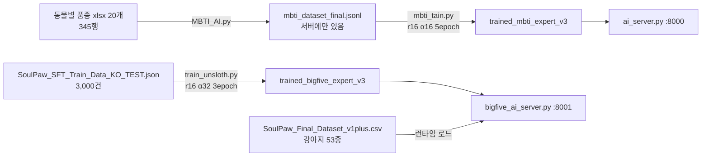

# 07. 학습 파이프라인 (현재 운영 버전)

- 로컬: `C:\Users\user1\Downloads\데이터셋_AI학습\더블체크_품종` / 서버: `/home/soulpow_2121/더블체크_품종`
- 이 문서는 운영 중인 v3 어댑터 2개를 만든 과정만 다룬다. 구버전 스크립트·어댑터·체크포인트는 [99a_archive.md](99a_archive.md)

## 1. 흐름

## 2. MBTI — 데이터 생성 `MBTI_AI.py`
| 단계 | 내용 |
|---|---|
| 입력 | `*_품종.xlsx` 20개. 헤더 위치를 자동으로 찾고 품종·성격·특징·주의·털·크기 컬럼을 키워드로 탐지 |
| 필터 | 빈 값, 헤더 단어, 크기 표기(`소형`, `kg` 등), 50자 초과 값 제외 |
| 증강 | 품종마다 8회 × 샘플 2개(형식 A/B) |
| 무작위로 정하는 값 | MBTI(16종), 환경(아파트·주택·원룸), 마당(O/X), 선호·비선호 동물, 제외 품종(30% 확률), 후보 동물 최대 8개 (정답 동물은 반드시 포함) |
| 출력 | instruction / input / **JSON output** (`animal_type, breed, reason, warning, environment_fit, size_text, guide`) |
| 문장 생성 | reason·environment_fit·guide는 규칙 기반 템플릿 문장 |

## 3. MBTI — 학습 `mbti_tain.py` → `trained_mbti_expert_v3`
| 항목 | 값 |
|---|---|
| 템플릿 | `### 지시:\n{instruction}\n\n### 입력:\n{input}\n\n### 응답:\n{JSON}` + EOS |
| 출력 정규화 | `clean_json_output()`: 9개 키로 다시 정리 (`preferred_animal`, `disliked_animal` 추가). 텍스트 출력은 줄 단위로 JSON 변환 |
| LoRA | r=16, α=16, dropout=0.05 |
| 학습 | batch 2 × grad_accum 4 = 실질 8, **5 epoch**, lr 5e-5 cosine, warmup 5%, adamw_8bit, packing 끔, epoch마다 저장 |

## 4. Big Five — 학습 `train_unsloth.py` → `trained_bigfive_expert_v3`
| 항목 | 값 |
|---|---|
| 데이터 | `SoulPaw_SFT_Train_Data_KO_TEST.json` 3,000건 (생성 스크립트는 폴더에 없음) |
| 템플릿 | `### 지시:\nJSON 포맷으로만 응답…\n\n{instruction}\n\n### 입력:\n{input}\n\n### 응답:\n{JSON}` |
| 출력 정규화 | `convert_output_to_json()`: 번호 텍스트 → `reason / warning / environment_fit / size_text / guide` |
| LoRA | r=16, **α=32**, dropout 0 |
| 학습 | 실질 batch 8 → epoch당 375 step, **3 epoch**(1,125 step), lr 5e-5 cosine, warmup 10%, logging 5 step |

## 5. ⚠️ 설계상의 문제
| # | 문제 | 영향 | 상세 |
|---|---|---|---|
| P1 | MBTI 라벨이 무작위 | 추천이 MBTI와 무관 | [05](05_model_and_data.md) |
| P2 | 학습 템플릿 ↔ 서빙 프롬프트 불일치 (틀, 필드 이름, 주거 값) | JSON 실패, fallback 증가 | [05](05_model_and_data.md) |
| P3 | Big Five 학습 과제(품종 선택 + 설명)와 서빙 과제(설명만)가 다름 | 설명 품질이 들쭉날쭉할 수 있음 | [05](05_model_and_data.md) |
| P4 | KO_TEST 3,000건 모두 동물 종류 칸에 품종 이름 | animal_type 칸에 품종을 쓰는 습관 (Big Five 서버는 동물을 강아지로 고정해서 영향 없음) | [08](08_datasets.md) |
| P5 | v3 어댑터, MBTI 학습 데이터, v3 학습 로그가 로컬에 없음 | 서버 장애 시 재현 불가 | 서버에서 백업 필요 |
