# 09. 화면 (UI) 캡처와 화면에서 확인한 문제

- 캡처 출처: 사용자 제공 스크린샷 12장 (2026-11-17 반영), 파일은 `docs/images/`
- 공통 레이아웃: 상단 헤더(로고 · 사용자 닉네임 · 로그아웃), 카드형 본문, 검은색 푸터. 테마 색은 주황(`#ff8c00`)과 갈색

## 화면 목록
| # | 화면 | 라우트 | 템플릿 |
|---|---|---|---|
| 1 | Big Five 설문 | `/Bigfive` | `Bigfive.html` |
| 2 | Big Five 결과 | `/result_big5` | `Bigfiveresults.html` |
| 3 | MBTI 추천 입력 | `/Animalbeer` | `Animalbeer.html` |
| 4 | 메인 (비로그인) | `/` | `index.html` |
| 5 | 메인 (로그인) | `/Login` | `Login.html` |
| 6–7 | 반려동물 Q&A (Gemini) | `/info` | `info.html` |
| 8 | 내 추천 동물 (최근 5개) | `/User_Animal` | `User_Animal.html` |
| 9 | 추천 통계 | `/Group` | `Group.html` |
| 10 | 통계 상세 (품종별) | `/Ani_in` | `Ani_in.html` |
| 11 | 게시판 목록 | `/board` | `board.html` |
| 12 | 게시글 상세 | `/detail/<bono>` | `detail.html` |

---

### 1. Big Five 설문
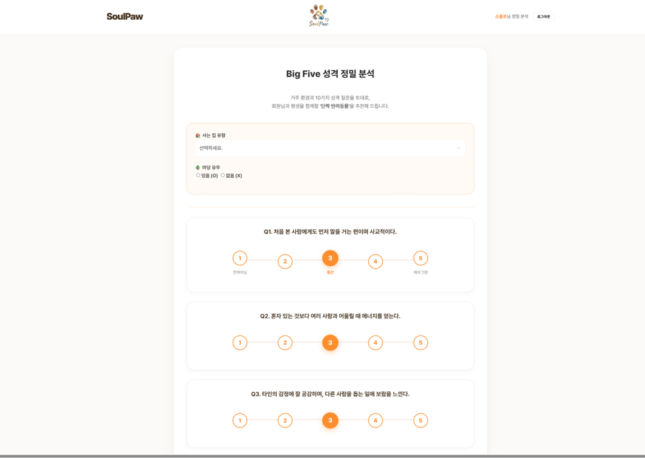
- 사는 집 유형(단독주택·빌라·아파트) + 마당 유무(**O / X**) + 10문항(1~5점, 기본값 3)
- 마당 선택은 마지막 실행 때 정상이었던 것으로 기억함 (사용자 진술, **재확인 필요**). 단, 로컬 사본 코드는 서버가 `"있음"`과 비교하도록 되어 있어 서버 최신본과의 대조가 필요함 → [99](99_known_issues.md) ✅ 표

### 2. Big Five 결과
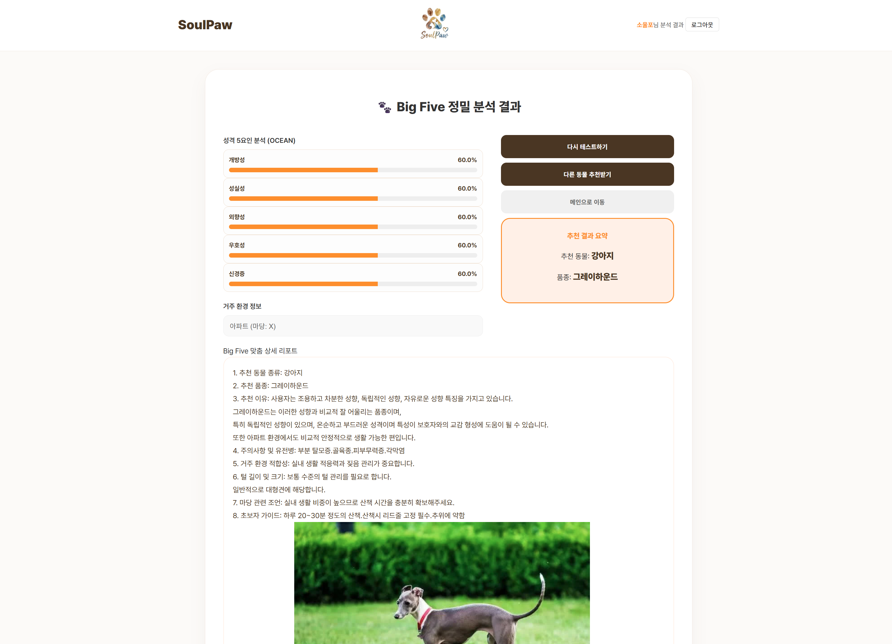
- 5요인 막대 그래프 (캡처는 10문항 모두 기본값 3 → 전부 60%), 추천 요약, 상세 리포트, 품종 사진
- 현재 서버의 리포트는 **9개 항목**이다: 1 동물 종류 · 2 품종 · 3 빅파이브 점수 대조 보고서 · 4 전문가 소견 · 5 유전 질환 · 6 주거 환경 · 7 외형 · 8 마당·산책 조언 · 9 양육 가이드. (이 캡처는 이전 서버의 8개 항목 출력이라 다시 캡처를 권장 → [99a](99a_archive.md))
- 사진은 `static/image/{동물}/{품종}.webp` 경로이고, 없으면 `.jpg`로 다시 시도한다. 품종 사진이 없으면 깨진 이미지가 표시될 수 있다
- 5요인 막대는 `data.big5.O … N`(0~1) × 100으로 그린다

### 3. MBTI 추천 입력
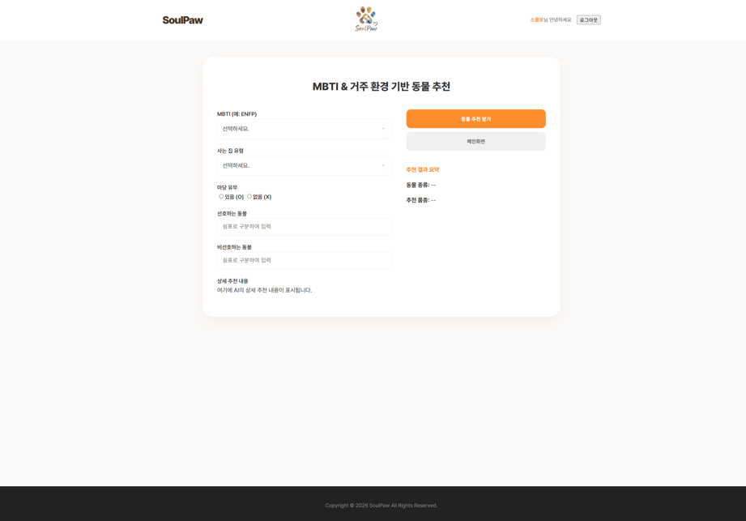
- MBTI(선택), 사는 집, 마당(O/X), 선호·비선호 동물(쉼표로 구분, 자유 입력)
- 사는 집 선택지는 **단독주택 / 빌라 / 아파트**인데, MBTI 학습 데이터(`MBTI_AI.py`)는 **아파트 / 주택 / 원룸**이다 → 빌라와 단독주택은 모델이 학습 때 본 적 없는 값 ([05](05_model_and_data.md) 핵심 문제 2)
- 선호·비선호가 자유 입력이라 `normalize_animal` 사전에 없는 표현("햄찌", "거북이" 등)은 그대로 통과한다

### 4–5. 메인
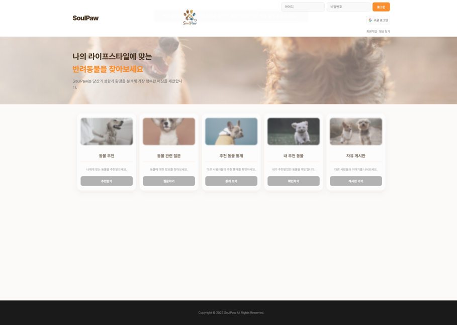
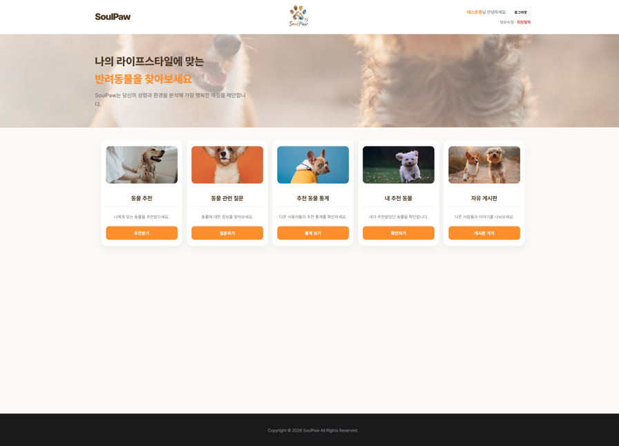
- 비로그인 화면에는 카드가 흐리게 표시된다. 로그인은 ID/PW와 **구글**만 있고, 카카오 로그인 버튼은 회원가입 화면(`NewUser.html`)에만 있다
- 비로그인 화면의 푸터는 `© 2025`, 다른 화면은 `© 2026` (사소한 불일치)

### 6–7. 반려동물 Q&A
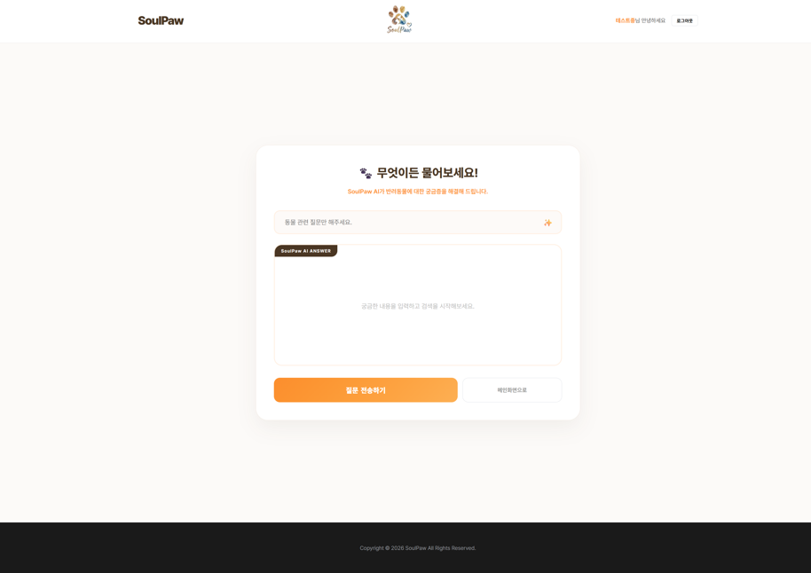
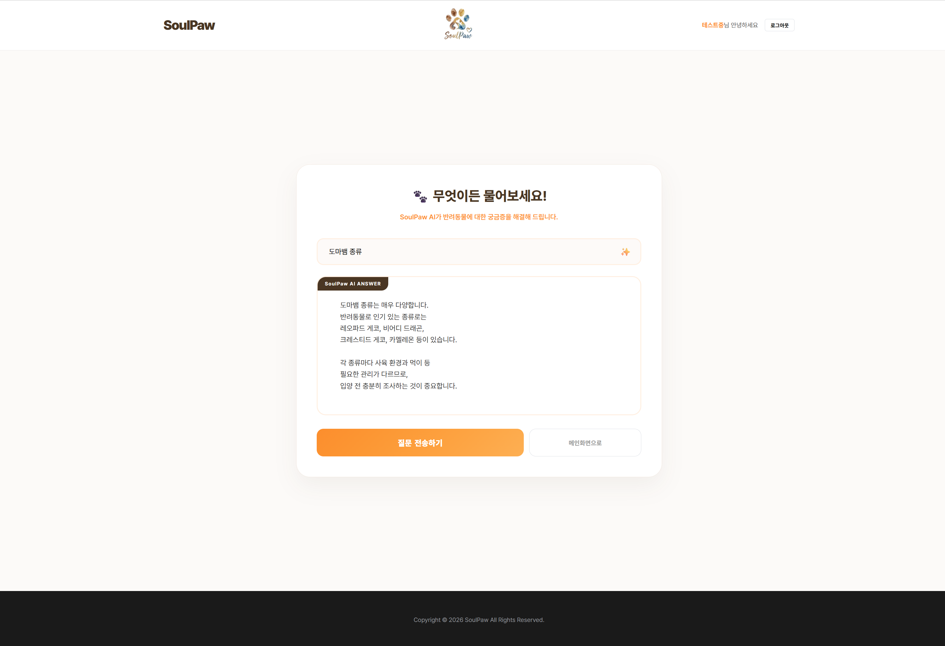
- Gemini 답변이 줄바꿈된 상태로 표시된다 (프롬프트에서 줄바꿈을 지시)
- ⚠️ 대화 객체를 모든 사용자가 공유하므로, 다른 사용자의 이전 질문이 답변에 영향을 줄 수 있다 ([98](98_security.md))

### 8. 내 추천 동물
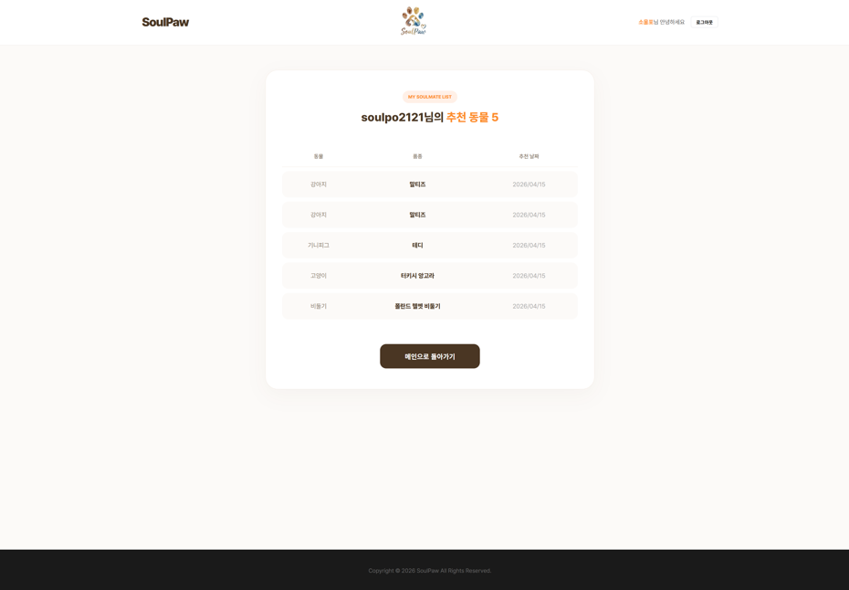
- 제목이 `soulpo2121님의 추천 동물 5`로 **닉네임이 아니라 로그인 ID**가 나온다. 헤더에는 닉네임(소울포)이 나와서 서로 다르다 → `US_name`으로 통일 권장
- 같은 날 **말티즈가 2번** 추천됐다 → "최근 5품종 제외" 로직을 넣기 전의 기록이거나, fallback 기본값(말티즈)이 기록된 것으로 추정 (**확인이 필요함**)

### 9. 추천 통계
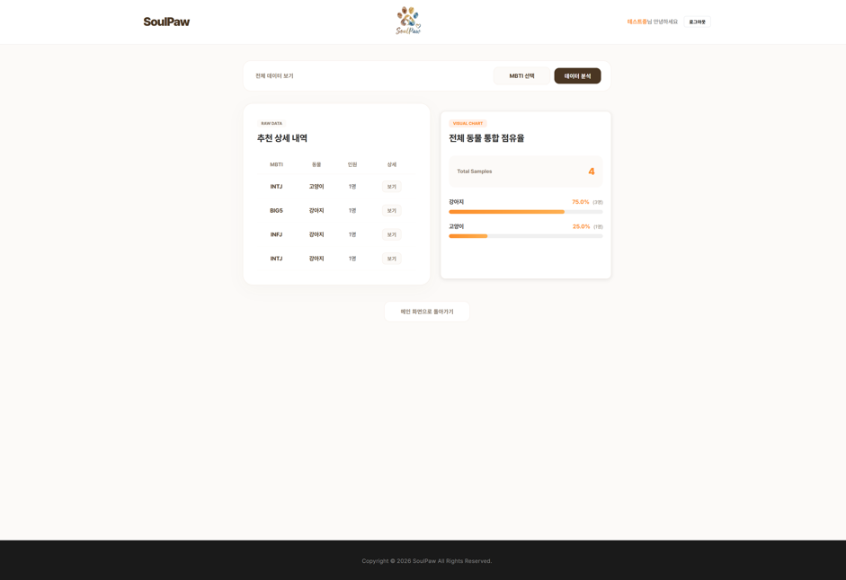
- **설계**: Big Five 추천은 `User_MBTI='BIG5'`로 저장되어 MBTI 16유형과 같은 표에서 하나의 유형처럼 집계된다. MBTI 기반 추천과 Big Five 기반 추천의 결과를 한 통계에서 비교하기 위한 **의도된 구성**이다
- 오른쪽 "전체 동물 통합 점유율"은 두 방식의 결과를 합산한다

### 10. 통계 상세
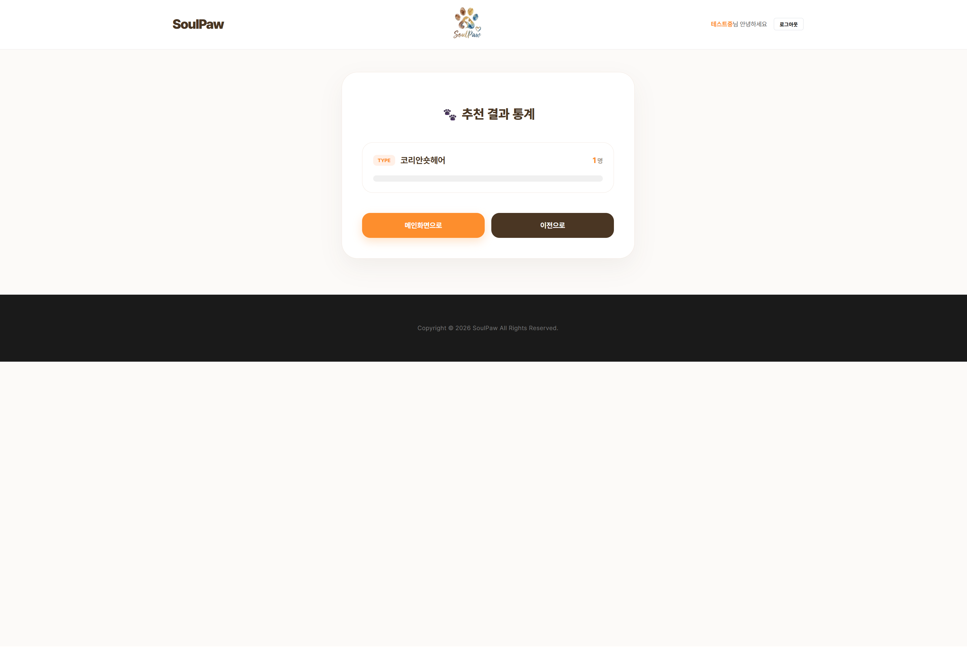
- 막대 그래프는 마지막 실행 때 정상이었던 것으로 기억함 (사용자 진술, **재확인 필요**). 캡처 시점의 빈 막대와 로컬 사본 코드(`max_val` 미전달)는 서버 최신본과 대조가 필요함
- 표시된 품종이 **코리안숏헤어**다. 이 값은 Flask에서 AI 서버 호출이 실패했을 때 쓰는 **기본값**(`고양이/코리안숏헤어`)과 같다. 즉 **AI 서버 장애 때의 기본값이 실제 추천처럼 DB와 통계에 저장되고 있다** (추정, 가능성 높음) → F18

### 11–12. 게시판
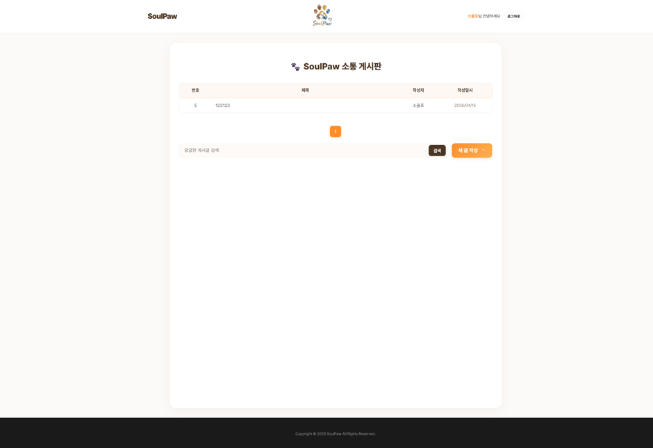
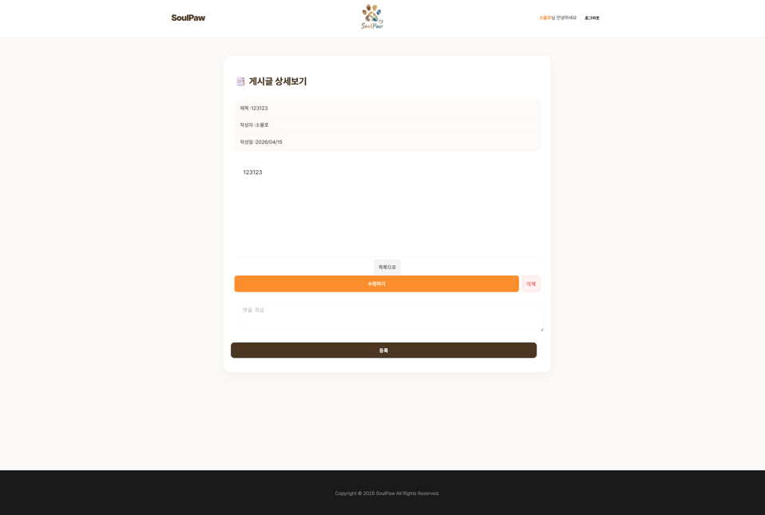
- 목록: 번호 · 제목 · 작성자(닉네임) · 작성일, 페이징, 제목 검색, 새 글 작성
- 상세: 작성자 본인에게만 수정·삭제 버튼이 보인다. 댓글 입력창
- 작성일이 `2026/04/15`로 날짜만 표시되고 시간은 없다
