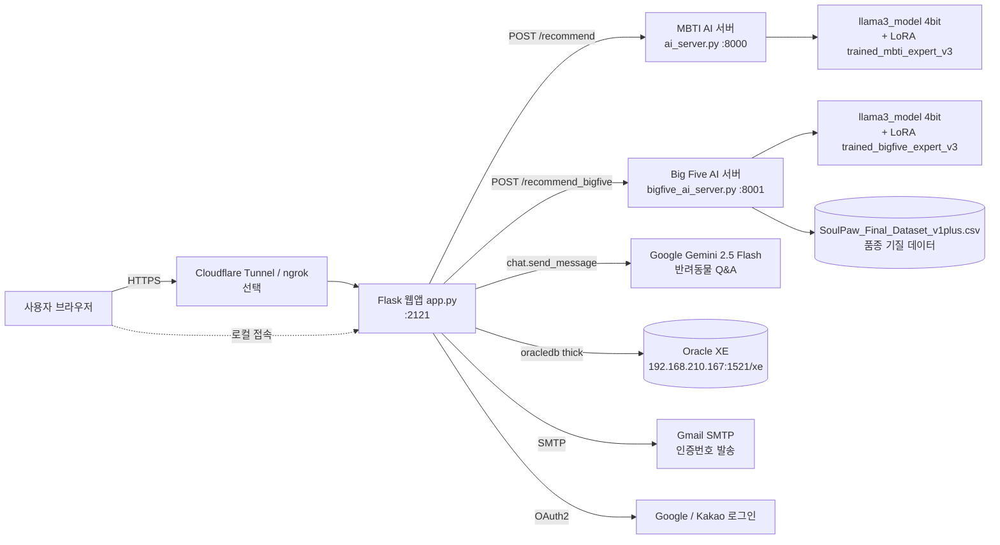

# SoulPaw — 성격 기반 반려동물 추천 서비스

> 사용자의 **MBTI** 또는 **Big Five 성격 점수**와 거주 환경(주거 형태·마당 유무)을 입력받아
> 직접 파인튜닝한 **Llama-3-8B + LoRA** 모델로 반려동물 종류·품종을 추천하고,
> 추천 이력·통계·커뮤니티 게시판·Gemini 반려동물 Q&A를 제공하는 Flask 웹 서비스.

- 문서 작성일: 2026-11-17 · **현재 운영 버전 기준** (구버전·실험 기록은 [99a_archive.md](99a_archive.md))
- 기준 폴더: `C:\Users\user1\Downloads\SOULPAW\Soulpow_AI` (6.1GB) + `C:\Users\user1\Downloads\데이터셋_AI학습\더블체크_품종` (2.8GB)
- 실제 운영 경로(코드 기준): `/home/soulpow_2121/...` (Linux GPU 서버)
- ⚠️ 모든 문서에서 비밀번호·API 키는 `***` 로 마스킹함 → [98_security.md](98_security.md)

---

## 1. 시스템 아키텍처



| 구성요소 | 파일 | 포트 | 역할 | 상세 문서 |
|---|---|---|---|---|
| 웹 서버 | `Gemini_test/Gemini_test/test/app.py` | 2121 | 화면·회원·게시판·통계, AI 서버 호출, DB 저장 | [01_flask_web.md](01_flask_web.md) |
| DB 계층 | `test/*DAO.py`, `*DTO.py`, `db_config.py` | – | Oracle 접근 | [02_database.md](02_database.md) |
| MBTI 추천 | `ai_server.py` | 8000 | LLM이 동물·품종·설명을 JSON으로 생성 | [03_mbti_ai_server.md](03_mbti_ai_server.md) |
| Big Five 추천 | `bigfive_ai_server.py` | 8001 | CSV 수치 매칭으로 품종 선정 + LLM이 소견 생성 | [04_bigfive_ai_server.md](04_bigfive_ai_server.md) |
| 모델 | `llama3_model/` + LoRA v3 2개 | – | 베이스 모델, 운영 어댑터 | [05_model_and_data.md](05_model_and_data.md) |
| 학습 파이프라인 | `데이터셋_AI학습/더블체크_품종/` | – | v3 학습 데이터 생성과 학습 | [07](07_training_pipeline.md), [08](08_datasets.md) |
| 실행 환경 | RTX 4070 12GB, Linux | – | 패키지, 폴더 정리 | [06_environment_and_cleanup.md](06_environment_and_cleanup.md) |

## 2. 실행 순서 (코드 기준 추정)

1. Oracle XE 기동 (`192.168.210.167:1521`, 서비스명 `xe`, 스키마 `Animal_DB`)
2. `python ai_server.py` → :8000 (모델 로딩 수 분 소요)
3. `python bigfive_ai_server.py` → :8001
4. `python app.py` → :2121
5. (외부 공개 시) `cloudflared tunnel --url http://localhost:2121` 또는 ngrok

### 실행 환경 (GPU)
- **NVIDIA RTX 4070, VRAM 12GB**
- AI 서버 2개가 각각 Llama-3-8B(4bit NF4)를 따로 로딩한다. 모델 하나에 약 5.5~6GB, 여기에 CUDA 컨텍스트와 생성 중 KV 캐시가 더해진다.
  → 두 서버를 동시에 띄우면 **12GB 한계에 거의 닿는다**. Big Five 서버가 동시에 2건을 생성(`max_workers=2`)하면 OOM 위험이 커진다.
- 개선안: 베이스 모델은 **한 번만 로딩**하고, PEFT 멀티 어댑터(`load_adapter` 2개 + 요청마다 `set_adapter`)로 MBTI와 Big Five를 한 프로세스에서 처리한다. VRAM 사용량을 절반 가까이 줄일 수 있다 ([99_known_issues.md](99_known_issues.md) F14).

필요 패키지(코드 import 기준): `flask`, `oracledb`, `argon2-cffi`, `flask-mail`, `authlib`, `google-generativeai`, `requests`, `werkzeug` / AI 서버: `fastapi`, `uvicorn`, `unsloth`, `peft`, `transformers`, `torch`, `bitsandbytes`, `pandas`, `numpy`
※ 폴더 안 `venv/`에는 `oracledb`·`argon2`·`flask_mail`·`authlib`가 없음 → 실제 실행 환경은 별도 서버로 추정

## 3. 폴더 지도 (운영에 쓰는 파일만)

```
SOULPAW/Soulpow_AI/
├── ai_server.py                  MBTI 추천 서버 (:8000)
├── bigfive_ai_server.py          Big Five 추천 서버 (:8001)
├── llama3_model/          5.4GB  베이스 모델
├── docs/                         ← 이 문서들 (images/ 화면 캡처 12장)
└── Gemini_test/Gemini_test/
    ├── GeminiDB.sql              DB 스키마 초안 (실제 DB와 불일치 있음 → 02)
    └── test/                     ★ 웹 애플리케이션
        ├── app.py                Flask 메인 (1,612줄)
        ├── UserDAO/DTO.py, AnimalDAO/DTO.py, BoardDAO/DTO.py, db_config.py
        ├── templates/            HTML (운영 20개)
        └── static/               CSS 34개 + image/

데이터셋_AI학습/더블체크_품종/
├── MBTI_AI.py                    MBTI 학습 데이터 생성
├── mbti_tain.py                  MBTI v3 학습
├── train_unsloth.py              Big Five v3 학습
├── *_품종.xlsx (20개)             동물별 품종 원천 데이터
├── SoulPaw_SFT_Train_Data_KO_TEST.json   Big Five 학습 데이터
└── SoulPaw_Final_Dataset_v1plus.csv      Big Five 서버 런타임 데이터

리눅스 서버에만 있음: trained_mbti_expert_v3/, trained_bigfive_expert_v3/, mbti_dataset_final.jsonl
```

> **깃 저장소**: 모델 가중치(`llama3_model/`, LoRA v3)는 용량 때문에 저장소에서 제외했다. 비밀키는 `test/.env`에 있으며 저장소에는 양식(`.env.example`)만 올라간다 → [06](06_environment_and_cleanup.md)

그 밖의 파일(구버전 코드, 실험 데이터, 이전 어댑터와 체크포인트 약 2.7GB, 바이너리, 자동 생성 파일)은 [06](06_environment_and_cleanup.md)과 [99a](99a_archive.md)에 목록으로만 정리했다.

## 4. 문서 목록
- [01_flask_web.md](01_flask_web.md) — 라우트 전체, 화면 흐름
- [02_database.md](02_database.md) — 테이블·DAO 매핑, 스키마 불일치
- [03_mbti_ai_server.md](03_mbti_ai_server.md)
- [04_bigfive_ai_server.md](04_bigfive_ai_server.md)
- [05_model_and_data.md](05_model_and_data.md) — 모델, VRAM, **MBTI 무작위 라벨, 템플릿 불일치**
- [06_environment_and_cleanup.md](06_environment_and_cleanup.md) — 실행 환경, 폴더 정리, .gitignore
- [07_training_pipeline.md](07_training_pipeline.md) — v3 학습 과정
- [08_datasets.md](08_datasets.md) — 운영 데이터셋
- [09_ui_screens.md](09_ui_screens.md) — 화면 캡처 12장, 화면에서 확인한 버그
- [98_security.md](98_security.md) — 🔴 먼저 읽을 것
- [99_known_issues.md](99_known_issues.md) — 버그 목록 + 수정 우선순위
- [99a_archive.md](99a_archive.md) — 부록: 구버전·실험 기록
